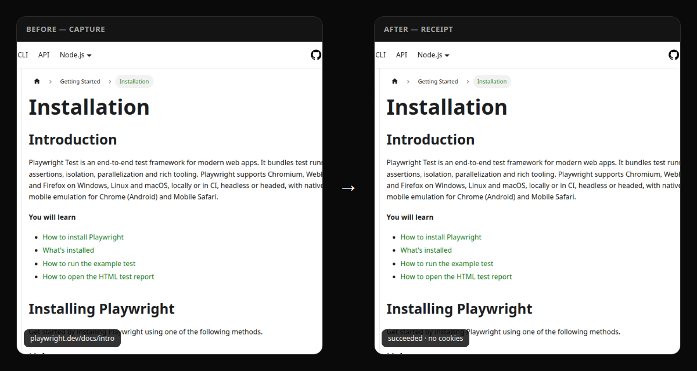
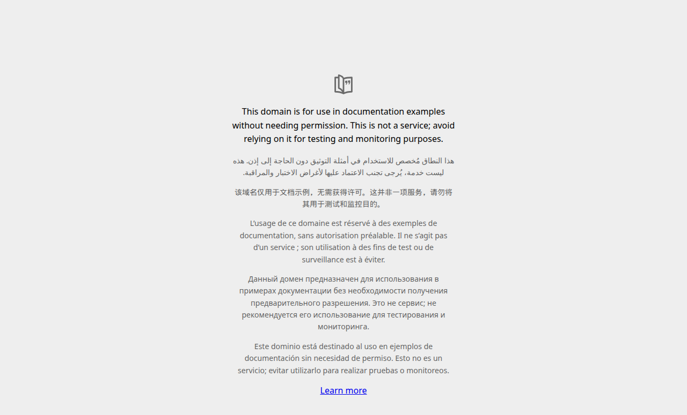
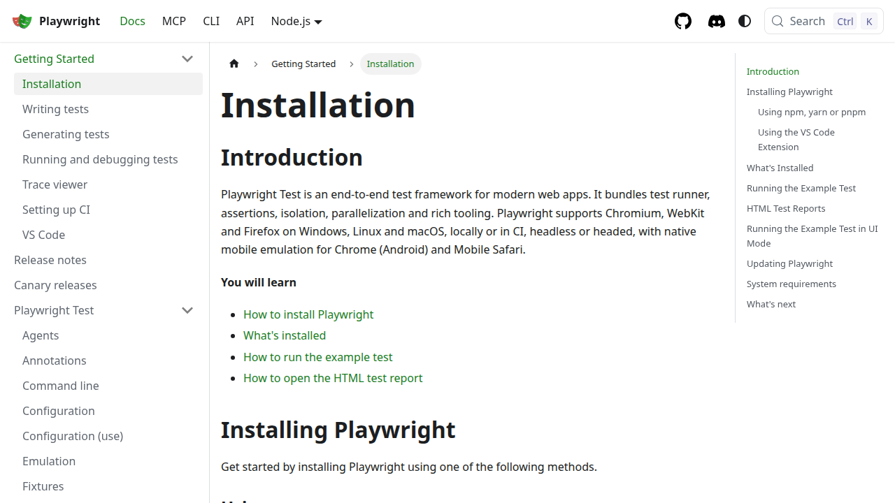

<p align="center">
  
</p>

<h1 align="center">TabHandoff</h1>

<p align="center">
  <strong>The open handoff protocol for AI agents.</strong><br/>
  <em>Your AI was here. Now the next one can pick up.</em>
</p>

<p align="center">
  Capture → Package → Continue · MIT · no cookies by default<br/>
  <a href="https://github.com/kodyepalmer-tech/TabHandoff">github.com/kodyepalmer-tech/TabHandoff</a>
</p>

---

## One-command install

```bash
curl -fsSL https://raw.githubusercontent.com/kodyepalmer-tech/TabHandoff/main/scripts/install.sh | bash
```

Node 22+. Clones to `~/tabhandoff`, builds, installs Chromium, runs `init`. No account.

Already cloned? `./scripts/install.sh`

---

## Demo (30 seconds)

```bash
cd ~/tabhandoff
node packages/cli/dist/index.js run \
  --url https://playwright.dev/docs/intro \
  --instruction "Extract the page title and first three getting-started steps as markdown" \
  --wait
```

You get a **shareable receipt** — markdown + screenshots + Task Card — under `~/.tabhandoff/receipts/<id>/`.

<p align="center">
  
</p>

<p align="center">
  
  &nbsp;
  
</p>

Live run against `playwright.dev/docs/intro` (`b8f51071-…`): isolated Chromium, DOM extract, receipt written — cookies/creds never transferred.

---

## The loop

| Step | What happens |
|---|---|
| **1. Capture** | Point TabHandoff at a page (CLI/MCP today; browser “Handoff” next) |
| **2. Package** | Portable Task Card: URL, context, instructions, permitted evidence |
| **3. Continue** | Another agent resumes in an **isolated** browser and returns a receipt |

**Safety default:** cookies, credentials, and authenticated browser state are **not** transferred.

---

## Why star / contribute

- **Protocol first** — open Task Cards + MCP tools other agents can implement
- **Proof every run** — postable receipts (the shareable artifact)
- **Small v0.1** — MCP + Playwright + CLI; no marketplace, no cookie vault

---

## What ships in v0.1

| Surface | Status |
|---|---|
| MCP `handoff_create` / `handoff_status` / `handoff_receipt` | ✅ |
| Playwright **ephemeral** Chromium runner | ✅ |
| CLI (`init` / `run` / `capture` / `status` / `receipt` / `doctor`) | ✅ |
| Receipt markdown + screenshots + Task Card YAML | ✅ |

**Not in v1:** marketplace, hosted cloud platform, cookie/session vault, general-purpose agent.

**Mascot (art later):** pigeon messenger.

> We do **not** claim [openhandoff.com](https://openhandoff.com) (unrelated SaaS). Product is **TabHandoff** (`tabhandoff` / `@tabhandoff/*`).

---

## Clients

| Client | Path |
|---|---|
| **Cursor** | [docs/clients/cursor.md](docs/clients/cursor.md) |
| **Claude Desktop** | [docs/clients/claude-desktop.md](docs/clients/claude-desktop.md) |
| **ChatGPT** | [docs/clients/chatgpt.md](docs/clients/chatgpt.md) |
| **Grok** | [docs/clients/grok.md](docs/clients/grok.md) |
| **CLI** | Works alone |

```json
{
  "mcpServers": {
    "tabhandoff": {
      "command": "node",
      "args": ["/ABS/PATH/TO/tabhandoff/packages/mcp/dist/stdio.js"]
    }
  }
}
```

---

## Brand assets

| Asset | Path |
|---|---|
| App icon / avatar (hero) | [`docs/assets/tabhandoff-app-icon.png`](docs/assets/tabhandoff-app-icon.png) |
| Logo (same mark) | [`docs/assets/tabhandoff-logo.png`](docs/assets/tabhandoff-logo.png) |
| SVG mark (two tabs + one arrow) | [`docs/assets/tabhandoff-mark.svg`](docs/assets/tabhandoff-mark.svg) |
| GitHub social preview (1200×630) | [`docs/assets/tabhandoff-og.png`](docs/assets/tabhandoff-og.png) |
| Demo (static strip) | [`docs/assets/tabhandoff-demo-strip.png`](docs/assets/tabhandoff-demo-strip.png) |

Repo settings → Social preview → upload `docs/assets/tabhandoff-og.png`. Use the **app icon PNG** as the org/user avatar.

---

## Monorepo

```
packages/
  protocol/   @tabhandoff/protocol
  runner/     @tabhandoff/runner
  mcp/        @tabhandoff/mcp
  cli/        @tabhandoff/cli
docs/assets/  app icon · OG · static demo stills
scripts/install.sh
```

## License

MIT — OSS protocol first; commercial hosted routing later. Never paywall the core.
