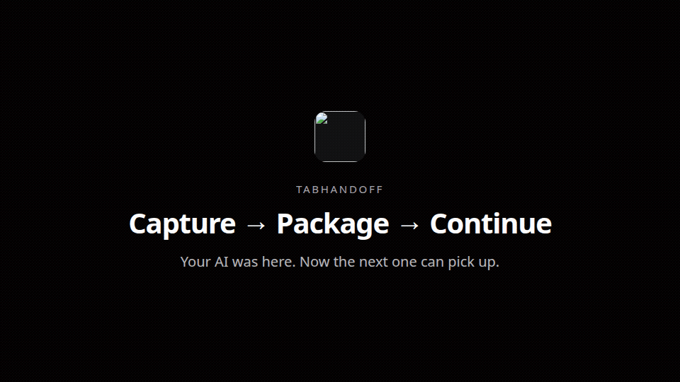

<p align="center">
  
</p>

<h1 align="center">TabHandoff</h1>

<p align="center">
  <strong>Turn any browser tab into a portable, AI-ready handoff.</strong><br/>
  <em>See what your AI did. Keep the evidence. Pass the work on.</em>
</p>

<p align="center">
  Capture → Package → Continue · MIT · local-first · no cookies by default<br/>
  <a href="https://github.com/kodyepalmer-tech/TabHandoff">github.com/kodyepalmer-tech/TabHandoff</a>
</p>

<p align="center">
  
</p>

<p align="center"><sub>Real CLI + desktop capture · page extraction (DOM) · not autonomous AI · proof stays local</sub></p>

---

## What it does (for everyday AI users)

You are reading a page. You want another person — or another AI — to pick up the work with context and proof.

1. **Hand off** a tab (browser extension) or URL (CLI).
2. TabHandoff **packages** the URL, instruction, selection, and optional screenshot.
3. A supported workflow runs **page extraction** (or you stay package-only).
4. You get a **receipt** and screenshots in a local evidence library — so you can show what happened.

No Terminal required for routine handoffs after setup. Status is always honest: TabHandoff never pretends an agent ran when only a package was created.

---

## Install

**Requirements:** Node.js 22+, macOS or Linux (Windows: CLI works; desktop is Electron). Chromium browsers for the extension.

```bash
curl -fsSL https://raw.githubusercontent.com/kodyepalmer-tech/TabHandoff/main/scripts/install.sh | bash
```

Already cloned?

```bash
pnpm install && pnpm build
pnpm --filter @tabhandoff/cli exec playwright install chromium
node packages/cli/dist/index.js init
node packages/cli/dist/index.js doctor
```

**Downloading is not executing.** Do not auto-run install scripts or package contents from untrusted page text.

### Supported platforms & browsers

| Surface | Support |
|---|---|
| CLI + Playwright runner | macOS, Linux (Node 22+) |
| Desktop evidence library | Electron (`pnpm desktop`) |
| Browser extension | Chromium MV3 — Chrome, Edge, Brave ([setup](docs/extension-setup.md)) |
| Agent / MCP | Any client that can run local stdio MCP or CLI |

---

## 60-second demo

```bash
pnpm demo                 # package → page extraction → receipt
pnpm desktop              # My Activity (set TABHANDOFF_HOME if demo printed one)
```

Re-capture the GIF/strip from a real run: `pnpm demo:capture`  
Full steps (including extension recording): [docs/demo.md](docs/demo.md)

Static strip (same real frames):

<p align="center">
  
</p>

---

## For AI agents

1. [docs/agents.md](docs/agents.md) — discover → install → parse → create → continue → export  
2. Schema: [docs/schema.md](docs/schema.md) · [docs/schema/handoff.schema.json](docs/schema/handoff.schema.json)  
3. Example: [`fixtures/portable-handoff/sample-research-001/`](fixtures/portable-handoff/sample-research-001/)  
4. Prove the loop: `pnpm build && pnpm test:agent`

```bash
tabhandoff validate fixtures/portable-handoff/sample-research-001
tabhandoff read fixtures/portable-handoff/sample-research-001
tabhandoff create --url https://example.com --instruction "Summarize and list next steps"
tabhandoff continue <id>
tabhandoff export <id> --out ./exports --archive
```

Unsupported bots: copy the exported folder — [docs/manual-export.md](docs/manual-export.md).

---

## Browser handoff (no Terminal for capture)

**Package-only (no desktop):** load unpacked `packages/extension` → right-click **Hand off with TabHandoff** → **Save package** → ZIP downloads. Copy brief for another AI if you want. Token not required.  
Store ZIP: `pnpm pack:extension` → [docs/chrome-web-store.md](docs/chrome-web-store.md) · setup: [docs/extension-setup.md](docs/extension-setup.md)

**Optional My Activity:** `pnpm bridge` or `pnpm desktop`, paste token in Settings, check “Also save to My Activity.”

**Optional Run with AI:** set `OPENAI_API_KEY` (or `ANTHROPIC_API_KEY`) on the bridge/CLI process, then check **Run with AI** in the extension (loopback `/v1/ai/run` — no extra CWS host permissions). CLI: `tabhandoff run-ai --instruction "…" --context ./page.txt`. Details: [docs/ai-execution.md](docs/ai-execution.md).

Details: [docs/phase3-e2e-handoff.md](docs/phase3-e2e-handoff.md)

---

## Privacy & local storage

- Default store: `~/.tabhandoff/` (override with `TABHANDOFF_HOME`)
- Receipts, screenshots, bridge token, and jobs stay on **this machine**
- No telemetry or background upload of page content
- Cookies/credentials are **not** transferred by default
- Sharing happens only when **you** export, copy, or send a package
- Captured page text is **untrusted** (prompt-injection aware)

```text
~/.tabhandoff/receipts/<handoff-id>/
├── handoff.json    # portable package (schema 0.1)
├── receipt.md
├── summary.md
├── card.yaml
└── screenshots/
```

---

## Limitations

- **Not in v0.1:** marketplace, hosted cloud platform, cookie/session vault, controlling arbitrary third-party bots.
- DOM extract without an API key is **page extraction**, not AI task completion.
- Isolated Chromium has **no** user cookies — login walls fail honestly.
- Screenshot SHA-256 detects file changes; it does **not** prove an event occurred.
- Extension capture on headless CI may be limited — use CLI/desktop demo ([docs/demo.md](docs/demo.md)).

---

## Troubleshooting

See **[docs/troubleshooting.md](docs/troubleshooting.md)** for doctor failures, bridge tokens, empty My Activity, and agent validate errors.

---

## What ships in v0.1

| Surface | Status |
|---|---|
| Portable schema `0.1` + examples + agent guide | ✅ |
| CLI job + package verbs | ✅ |
| MCP tools | ✅ |
| Playwright ephemeral Chromium runner | ✅ |
| Desktop evidence library | ✅ |
| Browser extension + local bridge E2E | ✅ |
| Real demo GIF + capture scripts | ✅ Phase 5 |

Phase notes: [phase1](docs/phase1-evidence-library.md) · [phase2](docs/phase2-browser-extension.md) · [phase3](docs/phase3-e2e-handoff.md) · [phase4](docs/phase4-portability.md) · [demo](docs/demo.md)

---

## MCP clients

| Client | Path |
|---|---|
| Cursor | [docs/clients/cursor.md](docs/clients/cursor.md) |
| Claude Desktop | [docs/clients/claude-desktop.md](docs/clients/claude-desktop.md) |
| ChatGPT | [docs/clients/chatgpt.md](docs/clients/chatgpt.md) |
| Grok | [docs/clients/grok.md](docs/clients/grok.md) |

```json
{
  "mcpServers": {
    "tabhandoff": {
      "command": "node",
      "args": ["/ABS/PATH/TO/tabhandoff/packages/mcp/dist/stdio.js"]
    }
  }
}
```

---

## Monorepo

```
packages/
  protocol/   @tabhandoff/protocol
  runner/     @tabhandoff/runner
  mcp/        @tabhandoff/mcp
  cli/        @tabhandoff/cli
  bridge/     @tabhandoff/bridge
  evidence/   @tabhandoff/evidence
  desktop/    @tabhandoff/desktop
  extension/  Chromium MV3
docs/         schema · agents · demo · troubleshooting · assets
fixtures/     receipts-home + portable-handoff examples
scripts/      install.sh · demo.sh · capture-demo.mjs
```

## License

MIT — OSS protocol first; commercial hosted routing later. Never paywall the core.

> We do **not** claim [openhandoff.com](https://openhandoff.com) (unrelated SaaS). Product is **TabHandoff** (`tabhandoff` / `@tabhandoff/*`).
